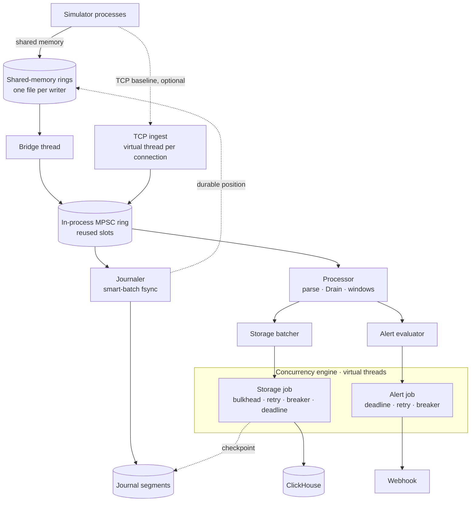

# low-latency-log-pipeline

Owner: Sarvadnyaa (GitHub: SAR-BAR). Java backend developer, ~2 YOE.
Goal: resume centerpiece for **trading / fintech / low-latency firms**.

## Working agreement for Claude
- The owner writes the **core algorithms** (ring buffers, shared-memory ring, journal, Drain, circuit breaker, bulkhead, retry). Interviews will dig into these.
- Claude's default role: explain, review, find bugs, design tests, write build config and boilerplate **when asked**.
- Explanations: plain language first, then technical detail, step by step, with the reason for every component. Avoid jargon unless asked.
- Never invent performance numbers. Use `[X]` placeholders until measured in this repo.

## Git workflow
- One branch per phase (`phase-1-ring`, `phase-2-journal`, ...), merged to `main` by PR when the phase's "done when" check passes.
- One commit = one task from the plan below. It compiles, tests pass, and it's small enough to explain.
- Commit style: `feat(core): ...`, `test(core): ...`, `bench: ...`, `docs: ...`, `chore: ...`.
- `mvn verify` must pass before every commit; CI runs the same.
- Measured numbers go into `docs/results.md` in the same commit as the benchmark.
- Never commit secrets, `.env`, journal files or shared-memory files.

## Plan in plain words

### Glossary
| Plain name | Technical name | Meaning |
|---|---|---|
| Shared mailbox file | Shared-memory (shm) ring file | A file both the simulator and the analyzer can see. The simulator drops logs into numbered boxes; the analyzer takes them out. Boxes are reused. |
| Conveyor belt | In-process ring buffer | A fixed row of reusable slots inside the analyzer that passes each log from worker to worker. |
| Journal | Write-ahead log | A notebook file on disk where every log is written first, so nothing is lost in a crash. |
| Starting a new journal file | Segment rolling | When one journal file is full, start a new one; delete old ones the database already has. |
| Memory counter | Allocation meter | Reports how much new memory the program asked for. We want almost zero (new memory causes pauses later). |
| Stopwatch records | Latency histogram | How long each log took: typical and slowest times. |
| Pattern finder | Drain | Turns similar log lines into one pattern, e.g. `Timeout connecting to <*> after <*>ms`. |
| Bookmark | Checkpoint | "Everything up to here is safely in the database." |
| Slowing the sender | Backpressure | When the system is full, the simulator waits instead of logs being dropped. |
| Breaker | Circuit breaker | If the database keeps failing, stop calling it for a few seconds, then try again. |

### Stages (following a log's journey)
| Stage | What it does | Tasks (one commit each) | Works when |
|---|---|---|---|
| 0. Setup | Repo, folders, automatic checks, database | Charter files · 5 Maven modules + tests · GitHub Actions · ClickHouse in Docker + tables + diagram | CI is green |
| 1. Logs enter | Simulator writes into the shared mailbox file; analyzer picks logs up | Mailbox file layout · writer (wait if full) · reader · several simulators, one file each · "your logs are saved" signal · connect the simulator · crash tests · *(optional)* one shared mailbox with variable-size logs | Several simulators, no missing or repeated logs |
| 2. Conveyor belt | Passes each log between the analyzer's workers | Position counter · simple belt · several senders · several workers on the same slot · tiny-belt (8 slots) tests | No lost, repeated or out-of-order logs |
| 3. Saved to disk | Journal | Journal file with log number + checksum · save many logs with one disk flush · new file when full, delete old ones · recovery after crash · crash test script | Force-kill test: zero lost logs |
| 4. Understood | Processor | Read time/level/service · pattern finder part 1 (split, spot changing parts) · part 2 (match or create pattern) · error counter for the last 60 s + spike detection · memory counter test | Correct patterns; memory test passes |
| 5. Database + alerts | Concurrency engine does slow work safely | Engine basics with time limit · limit calls + retries · breaker · batches of 5,000 / 100 ms · insert into ClickHouse without duplicates · bookmark + delete old journal files · webhook alert with 5-minute cooldown · database outage test | Outage test: nothing lost, full recovery |
| 6. Network (optional) | Second way in, for speed comparison | Simulator sends over network with resend · analyzer accepts and replies "saved" · compare shared file vs network | Comparison recorded |
| 7. Results | Prove it works and how fast | Stopwatch records · comparisons vs Java queues · final runs on Linux · README results + resume numbers | Results table complete |

**Build order:** 0 → 2 → 4 → 3 → 1 → 5 → 6 → 7 (the belt first, because everything plugs into it). About 2.5–3 months part-time.

Technical phase numbers used below map to stages: phase 1 → stages 2+4, phase 2 → stage 3, phase 3 → stage 1, phase 4 → stage 5, phase 5 → stage 6, phase 6 → stage 7.

## Goal (priority order)
1. **No data loss**: every accepted event survives a process crash or a database outage. Hard rule.
2. **Predictable low latency**: microsecond hand-off and processing; judged on p99.9 and max, not averages.
3. **Throughput**: high volume through batching and sharding, never at the cost of 1 or 2.

Under overload the system **slows producers down rather than dropping data**.
Not optimized: surviving machine/disk loss (single node), query speed, multi-machine scale.

## One-line pitch
An exchange-style event pipeline: producers write into a shared-memory ring buffer, a journal makes every event durable with group commit, a single-threaded processor that never allocates parses and pattern-matches each log, and a concurrency engine (virtual threads + structured concurrency) handles slow I/O with bulkheads, retries, circuit breakers and deadlines. Logs are the payload; the architecture (LMAX-style journal + business logic on one ring) is the point.

## Architecture


### Flow of one log
1. The simulator turns a log line into bytes and writes it into its shared-memory file: check for a free box (wait if full), write, set the done flag. It doesn't wait for anything else.
2. The bridge thread sees the done flag, copies the bytes into a slot of the in-process ring, and frees the box.
3. Journaler and processor read the same slot in parallel. The journaler appends to disk and fsyncs once per available batch, then publishes the durable position. The processor extracts level/service/time, finds the Drain template, updates the error counters, and writes results into the slot.
4. Storage batcher adds a row to a columnar batch (flush at 5,000 rows or 100 ms). Alert evaluator checks for a spike (with cooldown).
5. Both hand jobs to the engine and return immediately.
6. The engine runs jobs on virtual threads in a structured scope: ClickHouse insert, webhook alert.
7. ClickHouse confirms, the checkpoint advances, and journal segments below it are deleted. On restart, replay from the checkpoint.
8. A ring slot is reused once every consumer has passed it.

## Threading model (hard rule)
| Thread type | Used for | Why |
|---|---|---|
| Platform threads (pinnable on Linux) | Bridge, journaler, processor, storage batcher, alert evaluator | Always running, CPU-bound, never block on network; need isolation and predictable latency |
| Virtual threads | Engine tasks; TCP connections (if built) | Mostly waiting on I/O; cheap blocking |
| Structured concurrency | One `StructuredTaskScope` per engine job | Siblings cancelled on failure/deadline; no leaked tasks |

A platform thread never calls `scope.join()` or blocking I/O. It calls `engine.submit(...)`, which returns a `CompletableFuture` immediately.

## Components
### `core` (no dependencies)
- `Sequence`: padded counter (pad to 128 bytes: Apple Silicon cache lines), acquire/release access.
- In-process MPSC `RingBuffer`: power-of-2 size, `seq & mask`, batch claim, per-slot publish flags, gating on the slowest consumer.
- `BatchConsumer` with `endOfBatch` (enables smart batching).
- Wait strategies: busy-spin, `Thread.onSpinWait()`, yield, park.
- Shared-memory ring (FFM `MemorySegment` + `VarHandle`):
  - **v1 (simple):** one file per writer process; header (magic, size, write position, read position, durable position, each padded); fixed-size boxes with a done flag; single writer, single reader.
  - **v2 (optional upgrade):** one shared file for all writers; CAS claim; records `[int length][int type DATA|PADDING][long timestamp][payload]`, 8-byte aligned; padding record at wrap; abandoned-record timeout (1 s); reader validates every length.
- Metrics: pre-allocated latency histogram (p50/p99/p99.9/max); allocation meter (`ThreadMXBean#getCurrentThreadAllocatedBytes`).

### `engine` (keep thin, ~1,500 lines max)
- `submit(lane, deadline, job)` → `CompletableFuture`.
- Lanes: max jobs in progress per lane; reject immediately when full (backpressure signal).
- Virtual thread per job → `StructuredTaskScope`; subtasks forked on virtual threads.
- Deadline via `ScopedValue`: scope timeout and cap on waits and retries.
- Bulkhead: `Semaphore` per resource (ClickHouse = 8).
- Retry: exponential backoff + jitter, retryable errors only, never past the deadline.
- Circuit breaker: CLOSED → OPEN → HALF_OPEN; failure rate over circular time buckets (≥ 50% over 10 s, min 20 calls), 5 s open, 1 probe.

### `agent-client` (used by the owner's simulator)
- `ShmLogWriter`; can wait for the durable position.
- (Phase 5) `TcpLogSender`: frames `[int frameLength][long batchId][int count]` + `count × ([int logLength][bytes])`; ack `[long batchId]`; HELLO with producer id and last acked batch; resend unacked.

### `analyzer`
- `ShmIngestBridge` (platform thread; reads all writer files).
- `LogEvent` slot: raw `byte[]` + length, receive time, source and sequence ids, parsed fields written in place.
- `Journaler`: 256 MB pre-allocated memory-mapped segments; record `[int length][long sequence][int CRC32][bytes]`; one `force()` per available range.
- Recovery: scan from checkpoint, verify CRC, truncate at the first torn record, replay through the normal path.
- `Processor` (no steady-state allocation): byte-level parsing; Drain with token offsets in reused `int[]`, byte-scan masking (no regex), FNV-1a, primitive `long → int` maps, `int[]` templates with `WILDCARD`, bounded `maxChildren`; 60 one-second circular buckets per service.
- `StorageBatcher`: columnar batches from a fixed `BatchPool`; flush at 5,000 rows or 100 ms.
- `AlertEvaluator`: EWMA spike detection, 5-minute cooldown per service, merges alerts when the lane is full.
- `CheckpointTracker`: advances only over a continuous completed range.
- I/O via JDK `HttpClient`: ClickHouse HTTP (8123) with insert deduplication token; webhook.
- (Phase 5) `TcpIngestServer`: one port, virtual thread per connection, max frame size, acks after durability, duplicate filtering.

### `bench` (hand-written; no JMH/JFR)
- Fixed-rate load measured from the scheduled send time (no coordinated omission).
- Ring vs `ArrayBlockingQueue` / `LinkedBlockingQueue` / `ConcurrentLinkedQueue` at 1/4/16 producers.
- False sharing on/off; wait strategies (latency vs CPU); single vs batch claim; smart-batching batch size vs load.
- Shared memory vs TCP (phase 5): hand-off latency and CPU per log; `TCP_NODELAY` on/off.

## Technical phase plan
| Phase | Steps (one commit each) | Done when |
|---|---|---|
| 0 Setup | 0.1 charter files · 0.2 Maven modules (`core`, `engine`, `agent-client`, `analyzer`, `bench`), JDK 26 + `--enable-preview`, JUnit 5 · 0.3 GitHub Actions CI · 0.4 Docker Compose (ClickHouse) + `clickhouse/init.sql` + `docs/architecture.md` | `mvn verify` green in CI |
| 1 Ring + processor (3 wk) | 1.1 `Sequence` + wait strategies · 1.2 single-producer `RingBuffer` + `BatchConsumer` · 1.3 multi-producer CAS + batch claim + publish flags, 16-producer stress test · 1.4 consumer gating + slow-consumer checksum test · 1.5 `LatencyHistogram` + `AllocationMeter` · 1.6 `LogEvent` + byte-level `LogParser` + allocation test · 1.7 Drain tokenizer/masking/`TokenDictionary` · 1.8 Drain tree/templates · 1.9 `SlidingWindowCounter` + EWMA · 1.10 `Processor` end-to-end with in-JVM producer · 1.11 benchmarks: ring vs JDK queues, false sharing | 8-slot stress tests pass; < 1 B/event |
| 2 Journal (2 wk) | 2.1 `JournalSegment` (mmap, CRC32) · 2.2 `Journaler` smart batching + durable sequence · 2.3 segment rolling + deletion below checkpoint · 2.4 recovery (CRC scan, truncate, replay) · 2.5 `scripts/crash-test.sh` · 2.6 smart-batching benchmark | `kill -9` under load: zero lost sequences |
| 3 Shared memory (2 wk) | 3.1 simple shm file (header + fixed boxes) · 3.2 `ShmLogWriter` + `ShmRingReader`, two-JVM tests · 3.3 `ShmIngestBridge` over several files · 3.4 durable position in shm header · 3.5 connect the owner's simulator · 3.6 crash tests · 3.7 *(optional)* shared multi-writer file with variable records | Several writer processes, no loss/dupes, killed writer doesn't block |
| 4 Engine + storage (2–3 wk) | 4.1 engine core (lanes, VT per job, `StructuredTaskScope`, `ScopedValue` deadline) · 4.2 `Bulkhead` + `Retry` · 4.3 `CircuitBreaker` · 4.4 `ColumnarBatch` + `BatchPool` + `StorageBatcher` · 4.5 ClickHouse writer + dedup token · 4.6 `CheckpointTracker` · 4.7 `AlertEvaluator` + webhook · 4.8 outage test | ClickHouse outage under load: breaker opens, recovers, nothing lost |
| 5 TCP (optional, 1 wk) | 5.1 wire format + `TcpLogSender` · 5.2 `TcpIngestServer` · 5.3 shm vs TCP + `TCP_NODELAY` benchmarks | Comparison recorded |
| 6 Results (1 wk) | 6.1 Linux pinned runs · 6.2 README results · 6.3 fill resume bullets | p50/p99/p99.9/max, throughput, 0 GCs, all experiments |

## Backpressure chain
| Where | Fills | Result | Policy |
|---|---|---|---|
| ClickHouse slow | Bulkhead | Tasks wait (bounded by deadline) | — |
| Storage jobs pile up | `BatchPool` | Batcher waits | Never lose data |
| Batcher stops | In-process ring | Bridge can't claim | — |
| Bridge stops | Shared-memory rings | Simulator writers wait | Producers absorb |
| Alert lane full | Engine rejects | Alerts merged per service | Never block |

## Circuit breakers
- ClickHouse OPEN: fail fast → batch not released → backpressure; the journal holds the data.
- Webhook OPEN: skip; record the alert locally as undelivered.

## Durability
- A log counts as safe only after an fsync covers it. Process crash: replay from the checkpoint; writers resend anything not yet durable. No loss.
- Duplicates in ClickHouse prevented with an insert deduplication token derived from each batch's sequence range.
- Documented limitation: single-node durability. Production answer: replicate the journal before acking, or Kafka in front.
- macOS `fsync` may not flush the drive cache (`F_FULLFSYNC` needed); label timings "measured on macOS"; final numbers on Linux.

## Key decisions (interview answers)
- **No Kafka:** Kafka is a replicated version of this journal; on one node it adds a network hop and a cluster. Trade-off: no replication.
- **Journal before ClickHouse:** closes the gap between receiving and storing (~100 ms normally, unbounded during an outage); durable in ~1 ms; keeps the network off the fast path; ClickHouse handles tiny inserts badly.
- **Ring buffer:** many producers into one ordered stream, several readers of one slot without copying, no allocation, absorbs bursts.
- **Separate processes + shared memory:** real log producers are separate programs; separate processes isolate crashes; shared memory is the fastest same-machine channel (no OS involvement per message). It's how trading systems connect processes on one box. TCP is the baseline that proves the difference.
- **Platform threads in the processing path:** isolation, no interference from I/O virtual threads, pinnable.
- **ClickHouse:** append-only data queried as aggregations over time and patterns = columnar OLAP. OpenSearch only if free-text search were primary.
- **Kappa, not Lambda:** one stream path; reprocess by replaying the journal.

## ClickHouse schema
```sql
CREATE TABLE logs.events (
    ts DateTime64(3), service LowCardinality(String),
    level Enum8('TRACE'=0,'DEBUG'=1,'INFO'=2,'WARN'=3,'ERROR'=4,'FATAL'=5),
    template_id UInt32, seq UInt64, message String CODEC(ZSTD(3))
) ENGINE = MergeTree PARTITION BY toDate(ts) ORDER BY (service, ts)
TTL toDateTime(ts) + INTERVAL 7 DAY;

CREATE TABLE logs.templates (template_id UInt32, service LowCardinality(String), template String, first_seen DateTime)
ENGINE = ReplacingMergeTree ORDER BY template_id;

CREATE MATERIALIZED VIEW logs.errors_per_minute_mv
ENGINE = SummingMergeTree ORDER BY (service, template_id, minute) AS
SELECT service, template_id, toStartOfMinute(ts) AS minute, count() AS errors
FROM logs.events WHERE level IN ('ERROR','FATAL') GROUP BY service, template_id, minute;
```

## Technologies
| Area | Technology |
|---|---|
| Language | Java (JDK 26 locally; target LTS 25) |
| Concurrency | Virtual threads, `StructuredTaskScope` (preview), `ScopedValue`, `VarHandle` |
| Shared memory / files | FFM API (`MemorySegment`, `Arena`), `FileChannel` memory mapping |
| Durability | Own write-ahead journal: memory-mapped segments, CRC32, group commit |
| Storage | ClickHouse over HTTP |
| HTTP | JDK `HttpClient` |
| Build / test | Maven 3.9 multi-module, JUnit 5 |
| Infra | Docker Compose (ClickHouse), GitHub Actions CI |
| Measurement | Own latency histogram, `ThreadMXBean` allocation meter, `-Xlog:gc`, fixed-rate load generator |
| Final runs | Rented Linux VM with `taskset` pinning |
| Not used on purpose | Kafka, LMAX Disruptor, Netty, Resilience4j, Chronicle/Aeron, JMH, JFR |

Build notes: `StructuredTaskScope` is a preview API, so compile and run with `--enable-preview`, with `--release` matching the installed JDK. `ScopedValue` and FFM are final. FFM may need `--enable-native-access=ALL-UNNAMED`.

## Environment
- One MacBook (macOS, Apple Silicon, Docker). Everything runs on it: simulator processes, analyzer, ClickHouse container, local webhook receiver.
- The owner's existing log simulator is adapted to `agent-client`: several processes, fixed rate with scheduled timestamps, unique sequence per log, scenarios (steady, burst, error spike in one service).

## Measurement requirements
- p50, p99, p99.9, max; in-process latency separate from end-to-end.
- Fixed-rate load measured from the scheduled send time.
- `-Xlog:gc`: zero GCs in a 10-minute steady run.
- Allocation test: < 1 byte/event after warm-up.
- Warm-up phase discarded before measuring.

## Out of scope
Live tail / WebSocket, Postgres, multiple alert channels, query API, Kafka, replication, multi-machine deployment.

## Resume bullets (fill `[X]` from measurements only)
**Low-Latency Event Pipeline** | Java, FFM API, Virtual Threads, Structured Concurrency, ClickHouse
- Built an exchange-style input path: producer processes write into shared-memory ring buffers; p99 hand-off **[X] µs** vs **[Y] µs** over TCP.
- Implemented a lock-free multi-producer ring buffer (batch claiming, per-slot publish flags, cache-line padding): **[X]M** events/sec, **[Y]×** `ArrayBlockingQueue` at 16 producers, zero allocation.
- Wrote a write-ahead journal with adaptive group commit (fsync batch grows from 1 to **[N]**) and crash recovery by replay; `kill -9` tests show zero lost events.
- Built an allocation-free processing thread (byte-level parsing, Drain on primitive data structures): 0 GCs over 10 minutes at **[X]** events/sec, p99.9 **[Y] µs**.
- Built a concurrency engine on virtual threads and structured concurrency with bulkheads, retries, circuit breakers and deadlines; during a ClickHouse outage, backpressure reached producers with no data loss and automatic recovery.
